# Trading Platform

A self-hosted dashboard for [Trading 212](https://www.trading212.com/) accounts, with an MCP server so AI agents can read your portfolio and place orders inside limits you set.

Built with Laravel 13, Filament 5, Livewire, Laravel MCP and Reverb, on PostgreSQL.

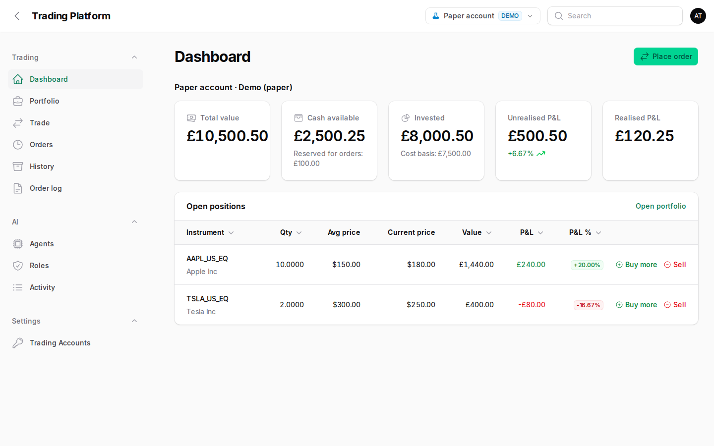

## Features

- **Multiple accounts.** Connect demo (paper) and live Trading 212 accounts and switch between them from the top bar. API keys are stored encrypted.
- **Portfolio and trading.** Account summary, open positions with P&L, and market, limit, stop and stop-limit orders.
- **Live-money guard.** Live accounts show a warning banner and every live order needs an extra confirmation.
- **History.** Filled orders, dividends and transactions pulled from Trading 212, plus a local log of every order placed through the app.
- **AI agents over MCP.** Give each agent a role with fine-grained permissions and limits (max quantity, max order value, orders per day, demo-only). Every tool call is logged as allowed, denied or error.
- **Rate-limit aware.** Requests follow Trading 212's per-account rate limits, and GET responses are cached so dashboards and agents don't hit the API too often.

## Screenshots

### Portfolio

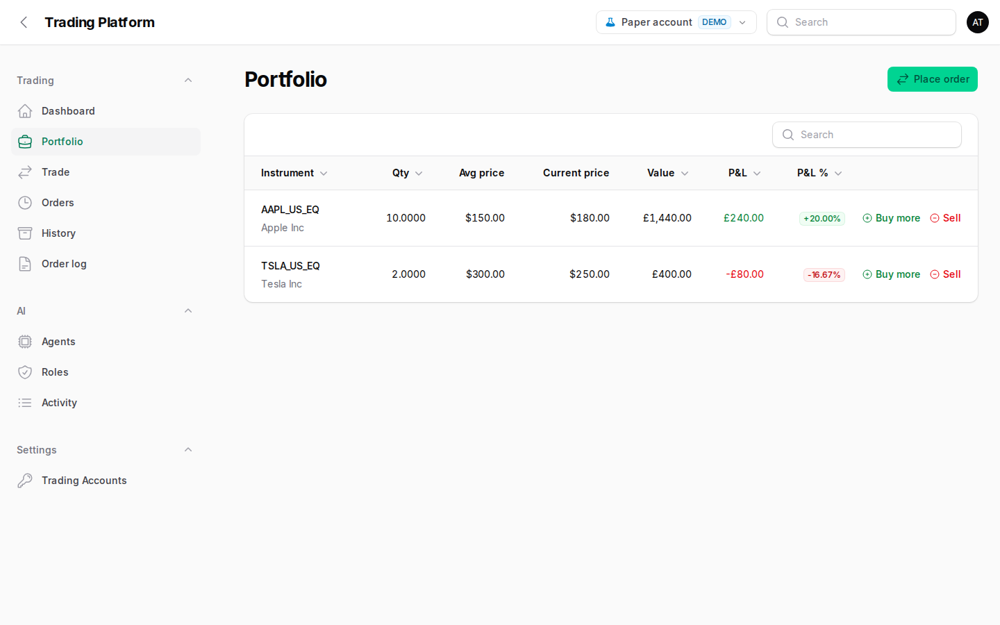

### Place an order

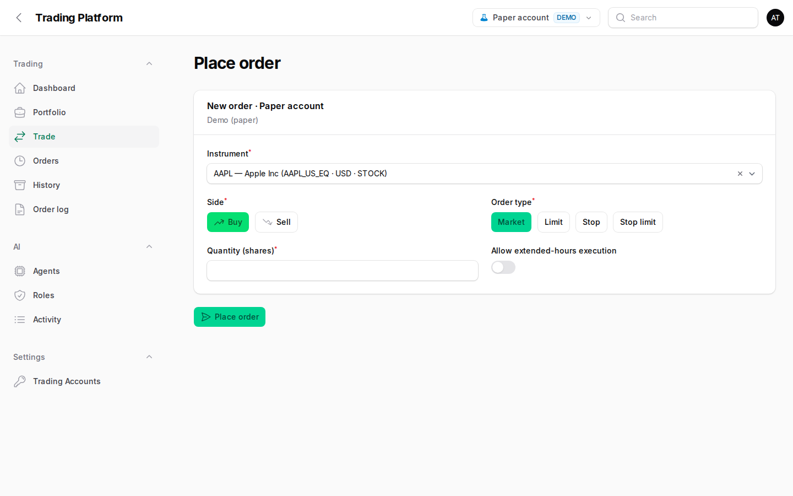

### Pending orders

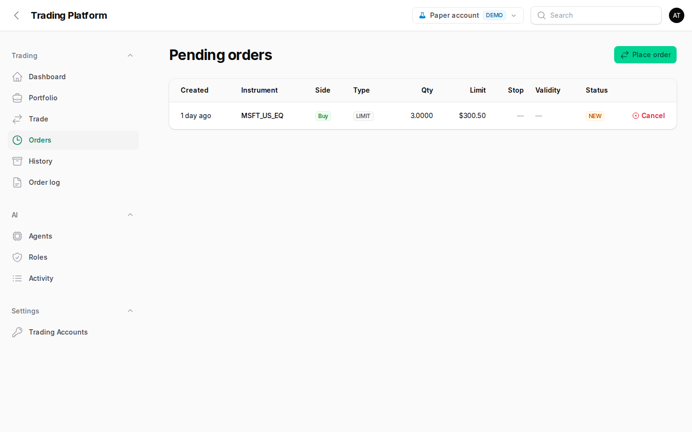

### History

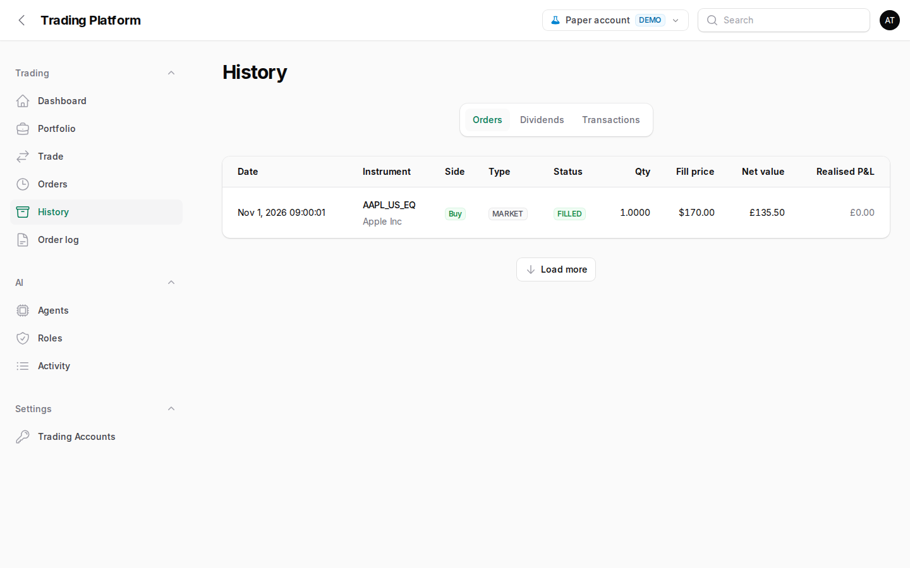

### Order log

Every order placed through the app or by an agent, and who placed it.

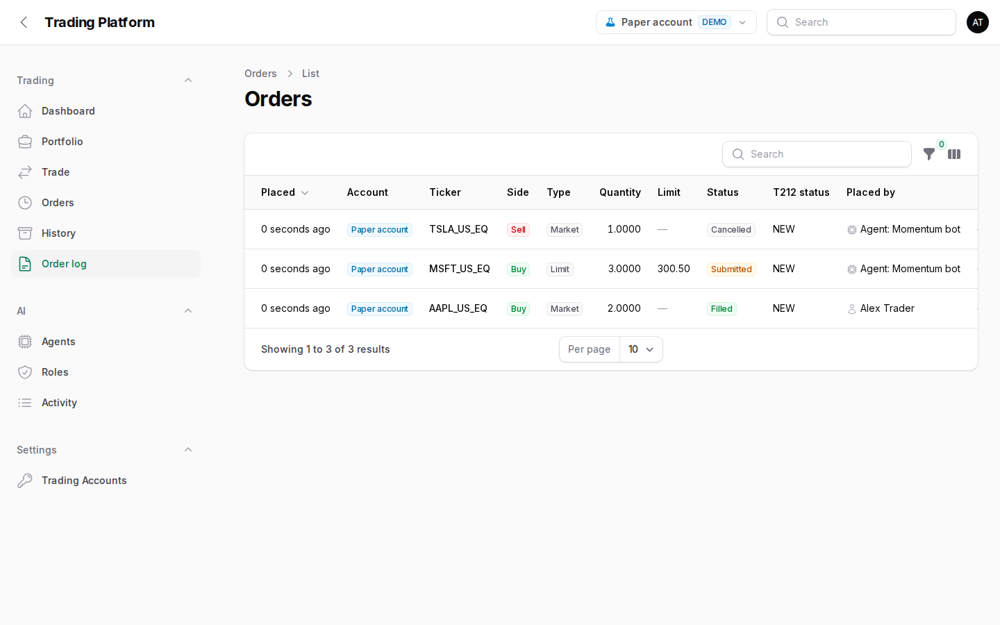

### AI agents

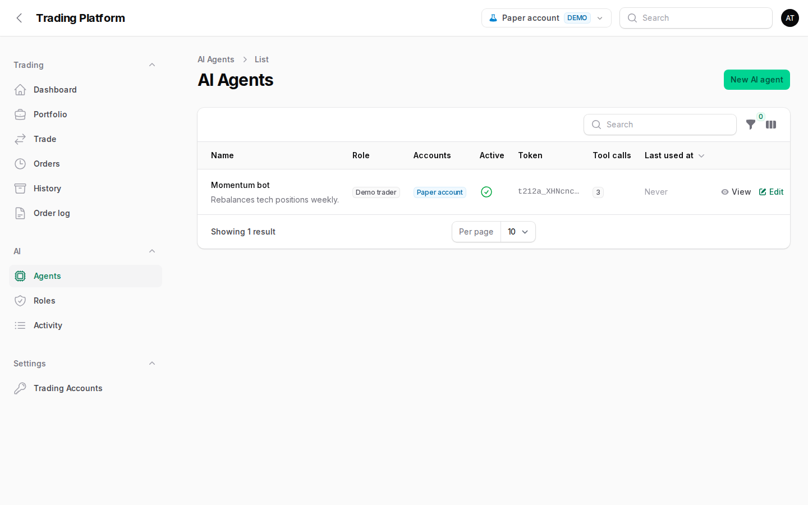

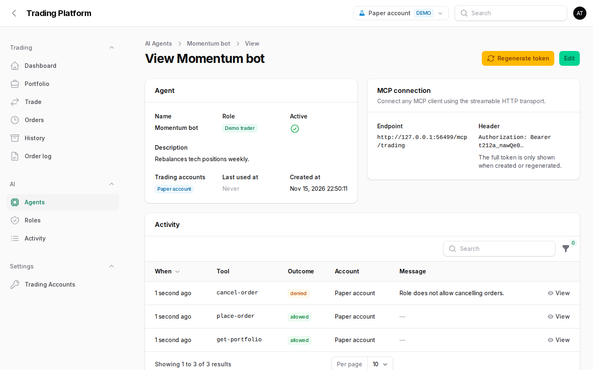

### Roles and permissions

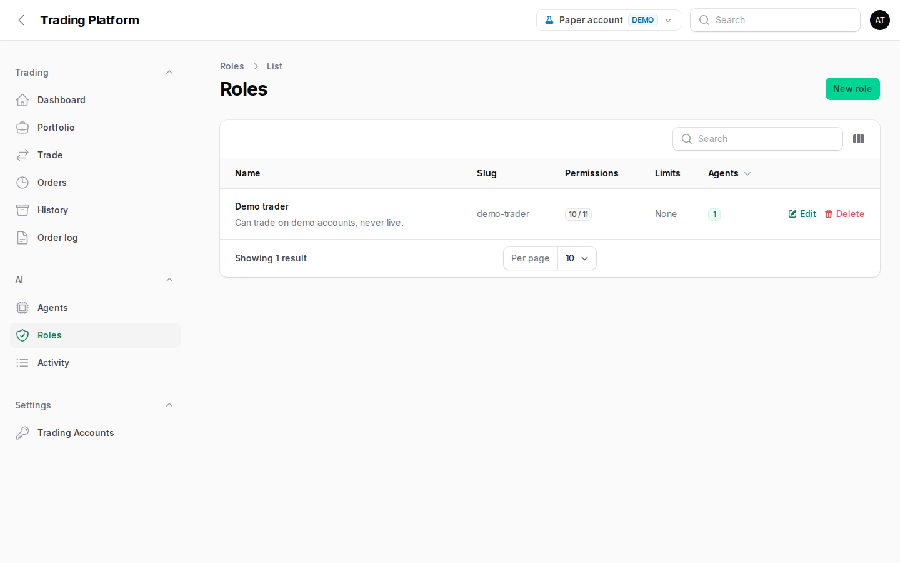

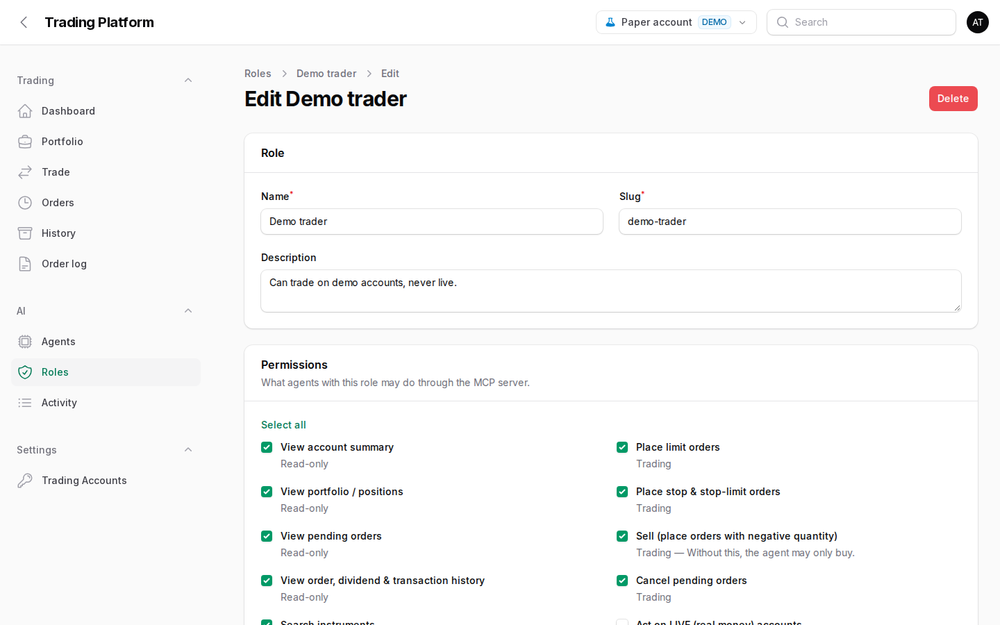

### Agent activity

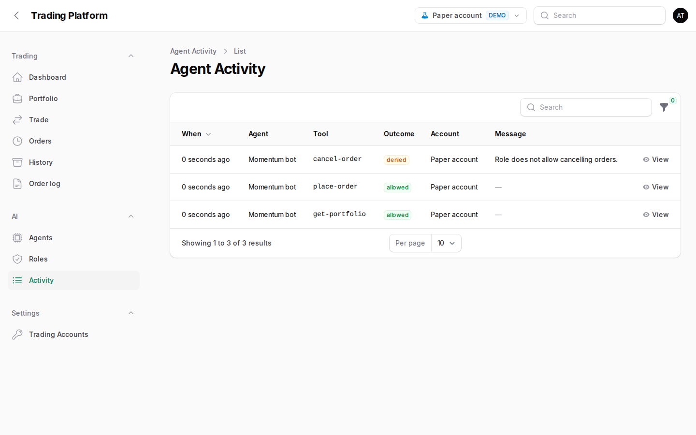

## Requirements

- PHP 8.3+
- PostgreSQL (also used for the cache, sessions and queue)
- Node.js with [pnpm](https://pnpm.io/)
- A Trading 212 account with API access (a demo account is enough to try it out)

## Setup

```bash
git clone <repo-url> trading-platform
cd trading-platform
cp .env.example .env   # set DB_* to your Postgres database
composer run setup     # installs deps, generates key, migrates, builds assets
php artisan db:seed    # creates admin@example.com / password (non-production only)
composer run dev       # queue, scheduler, Reverb, logs and Vite
```

Sign in, open **Settings → Trading Accounts**, and add your Trading 212 API key and secret. Use **Test connection** to check them.

## Connecting an AI agent

1. Create a role under **AI → Roles** and choose its permissions and limits.
2. Create an agent under **AI → Agents** and assign the role and accounts.
3. Copy the token. It is shown once; regenerate it if you lose it.

**Over HTTP** (streamable HTTP transport):

```
POST https://your-app/mcp/trading
Authorization: Bearer t212a_...
```

**Over stdio** (for local MCP clients):

```bash
MCP_AGENT_TOKEN=t212a_... php artisan mcp:start trading
```

### MCP tools

| Tool | What it does |
| --- | --- |
| `list-accounts` | Accounts the agent can use |
| `get-account-summary` | Cash, invested value and P&L |
| `get-portfolio` | Open positions |
| `list-pending-orders`, `get-order` | Pending orders |
| `get-order-history`, `get-dividends`, `get-transactions` | History |
| `search-instruments` | Find tickers |
| `place-order`, `cancel-order` | Trade, checked against the agent's role |
| `get-my-permissions` | The agent's role, permissions and limits |

There is also a `permissions` resource and a `portfolio-review` prompt.

## Artisan commands

| Command | Purpose |
| --- | --- |
| `php artisan trading212:sync {account?} [--now]` | Sync summary, positions and pending orders (scheduled every minute) |
| `php artisan trading212:test-connection {account}` | Check an account's API credentials |
| `php artisan trading212:agent-token {agent}` | Issue a new token for an agent (revokes the old one) |

## Testing

```bash
php artisan test --compact     # feature and unit tests
vendor/bin/pest tests/Browser  # browser tests (Playwright)
```

All tests fake the Trading 212 API, so no real account is needed. The screenshots above were captured the same way, using fake data.

## License

MIT
